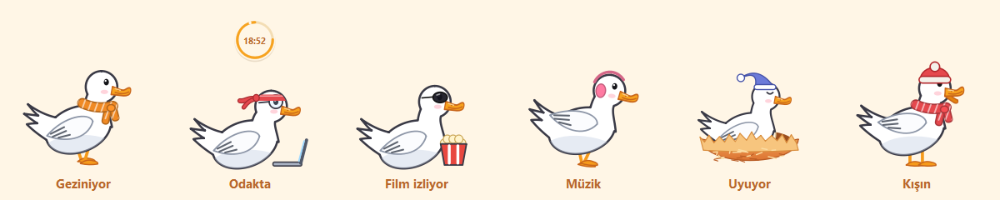

  

<h1 align="center">duckyduck</h1>

Windows masaüstünde yaşayan, ne yaptığını fark edip seninle birlikte yapan küçük bir ördek. 🦆

  

## Neler yapıyor?

- **Ekranında geziniyor.** Görev çubuğunun üstünde yürüyor, koşuyor, pencerelerin üstüne uçup oturuyor; pencereyi taşıyınca onunla gidiyor.
- **Ne yaptığını fark ediyor.** Ekran görüntüsü almaz; yalnızca öndeki pencerenin adına bakar:
  - kod yazarken / çalışırken gözlük ve kafa bandıyla laptopunun başında,
  - film izlerken patlamış mısırla, müzik dinlerken kulaklıkla dans ederek,
  - oyun oynarken oyun koluyla, mesajlaşırken telefonla,
  - bilgisayara dokunmadığında yuvasında uyuyarak.
- **Tam ekranda da kaybolmuyor**, seninle birlikte izliyor.
- **Çağırınca geliyor:** ekranda bir yere **sağ tuşla 1 saniye basılı tut**.
- **Sağ tık menüsü:** ördeğin çevresinde açılan düğmeler — notlar, yem ver, odak sayacı, sohbet, yavru ördek, kıyafet, pencereye çık, yerinde dur.
- **Notlar:** renkli kartlı, çizgili kâğıtlı bir not defteri (arama, sabitleme, renkler).
- **Besleme:** arada bir yere tohum düşer; uzun süre beslenmezse küser.
- **Yavru ördek:** bazen gelir, ördeğin ne yaptığını ve ne giydiğini taklit eder (biraz da sakardır).
- **Kıyafetler:** mevsime göre atkı, bere, çiçek, güneş gözlüğü; doğum gününde parti şapkası.
- **Odak sayacı:** 25 dakikalık odak süresi, bitince kutlama.
- **Sohbet:** bilgisayarında ücretsiz çalışan bir yapay zekâyla ([Ollama](https://ollama.com)) ördekle konuşabilirsin.
- **Eklentiler:** `eklentiler/` klasörüne kendi eklentini yazabilirsin (bkz. `eklentiler/BENIOKU.txt`).

## Kurulum

**Gerekenler:** Windows 10/11. Python yoksa kurulum kendisi teklif eder.

1. Bu depoyu indir (yeşil **Code** düğmesi → **Download ZIP**) ve zip'i kalıcı bir klasöre çıkar.
2. `kur.bat` dosyasına çift tıkla. Gerekli parçaları indirir, istersen sohbet için Ollama'yı kurar.
3. Ördek ekrana gelir ve doğum gününü sorar. Bilgisayar her açıldığında kendiliğinden gelir.

Tek dosyalık bir `.exe` hazırlamak istersen: `paylas.bat exe` (PyInstaller gerekir:
`pip install pyinstaller`). Oluşan exe çift tıklanınca kendini kurar.

## Gizlilik

- Notların, ayarların ve doğum günün yalnızca senin bilgisayarında, `veri/` klasöründe durur.
- Ördek ekran görüntüsü almaz; yalnızca öndeki pencerenin adını ve ne kadar süredir
  klavye/fareye dokunmadığını okur.
- Sohbet Ollama ile tamamen bilgisayarında çalışır; hiçbir şey internete gönderilmez.

## Dosyalar

| Dosya | Ne işe yarar |
|---|---|
| `ordek.py` | ördeğin kendisi ve her şeyi yöneten kısım |
| `cizim.py` | ördek, yavru, yuva, yem ve aksesuar çizimleri (hepsi kodla çiziliyor) |
| `yuva.py` | not defteri |
| `sohbet.py` | sohbet kutusu |
| `menu.py` | sağ tık halka menüsü |
| `nesneler.py` | yem ve yavru ördek |
| `dogumgunu.py` | doğum günü penceresi ve bilgi kartları |
| `logo.py` | logo |
| `pencereler.py` | Windows yardımcıları |
| `ayarlar.py` | ayarlar ve kayıtlar |
| `paylas.py` | kurulum paketi / exe hazırlama |
